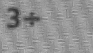
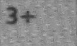
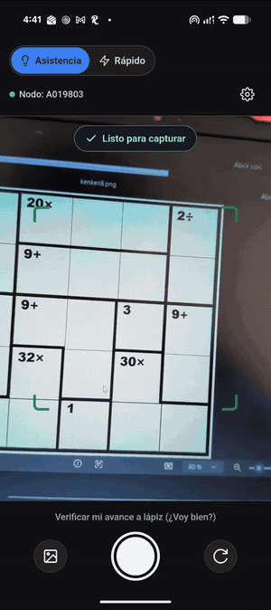
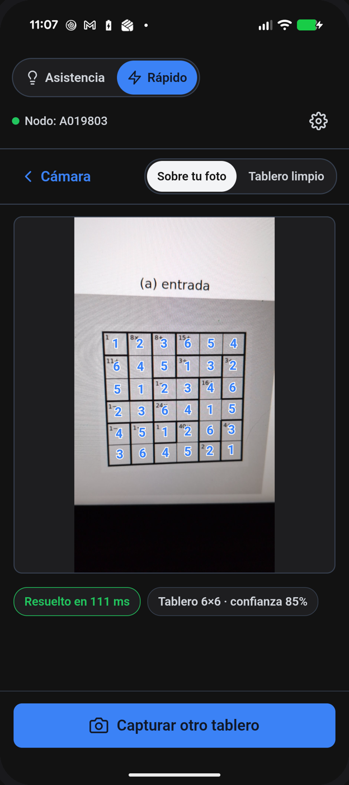
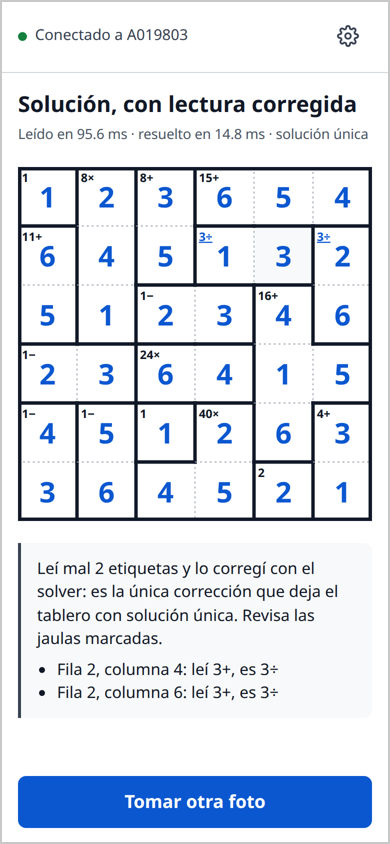
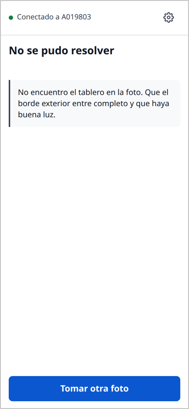
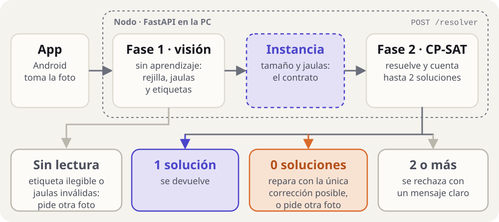
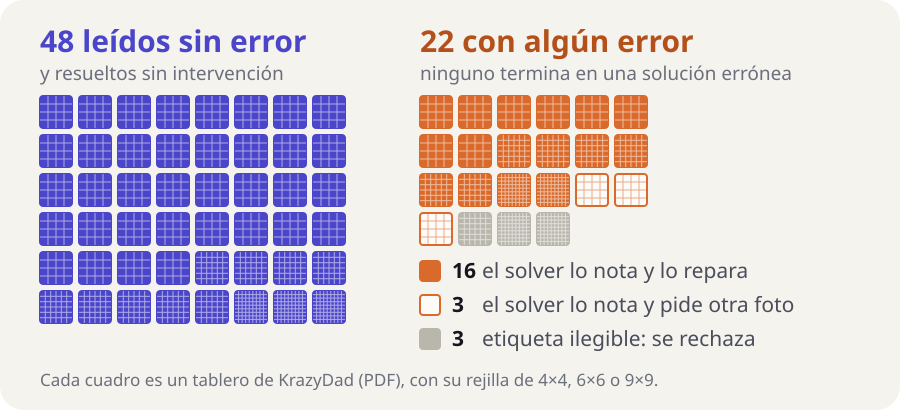

<a id="inicio"></a>

<div align="center">

<h1>KenKen desde una foto</h1>

<p>
  <strong>¿Qué sobrevive a una lectura equivocada?</strong><br>
  Le tomas una foto a un KenKen y el sistema te lo devuelve resuelto. Si la visión lee mal, el
  solver lo nota: corrige la lectura o pide otra foto, sin inventar una solución.<br>
  <sub>En 70 tableros publicados (PDF rasterizado), ninguno de los 22 mal leídos terminó en una
  solución errónea. Con 8 fotos de una pantalla, el nodo dio la solución en 2 y pidió otra foto
  en las otras 6.</sub>
</p>

<p>
  <a href="https://kenken.rosewt.dev"></a>
  <a href="informe/main.pdf"></a>
  <a href="https://huggingface.co/datasets/rosewt/kenken-tb1-fotos"></a>
  <a href="https://github.com/R0SEWT/cs-topics/releases/tag/tb1"></a>
</p>

<p>
  
  
  
  <a href="https://github.com/R0SEWT/cs-topics/actions/workflows/python.yml"></a>
  <a href="https://github.com/R0SEWT/cs-topics/actions/workflows/jade.yml"></a>
</p>

<p>
  <a href="#que-es">Qué es</a> ·
  <a href="#celular">En el celular</a> ·
  <a href="#como-funciona">Cómo funciona</a> ·
  <a href="#resultados">Resultados</a> ·
  <a href="#probarlo">Probarlo</a> ·
  <a href="#entregables">Entregables</a> ·
  <a href="#mapa">Mapa</a> ·
  <a href="#convenciones">Convenciones</a> ·
  <a href="#equipo">Equipo</a>
</p>

<sub>TB1 de <b>Tópicos en Ciencias de la Computación</b> · UPC 1ACC0058 · ciclo 2026-20 · Grupo 3</sub>

</div>

<details>
  <summary>Contenido</summary>
  <ol>
    <li><a href="#que-es">Qué es</a>: la idea, y <a href="#la-foto">la foto real de la animación</a></li>
    <li><a href="#celular">En el celular</a>: la demo grabada y las pantallas de la app</li>
    <li><a href="#como-funciona">Cómo funciona</a>: <a href="#fase-1">visión sin aprendizaje automático</a> y <a href="#fase-2">CP-SAT</a></li>
    <li><a href="#resultados">Resultados</a> en 70 tableros, y <a href="#limites">lo que no dicen</a></li>
    <li><a href="#probarlo">Probarlo</a>: tests, el nodo y la app, y <a href="#cifras">de dónde sale cada cifra</a></li>
    <li><a href="#entregables">Entregables del TB1</a>: informe, diapositivas, código y fotos</li>
    <li><a href="#mapa">Mapa del repo</a>: el resto del cuaderno del curso</li>
    <li><a href="#convenciones">Convenciones</a></li>
    <li><a href="#equipo">Equipo</a>, datos y uso de IA</li>
  </ol>
</details>

<a id="que-es"></a>

## Qué es

<picture>
  <source media="(prefers-color-scheme: dark)" srcset=".github/portada/heroe-oscuro.svg">
  <source media="(prefers-color-scheme: light)" srcset=".github/portada/heroe-claro.svg">
  
</picture>

Un KenKen es un cuadrado latino de n×n dividido en **jaulas**: grupos de celdas cuyos números,
con la operación de la etiqueta, tienen que dar su objetivo (`3÷`, `15+`, `40×`). Resolverlo
desde una foto plantea dos problemas que fallan de manera distinta: **percibir** el tablero y
**razonar** sobre él. Un solver de restricciones es exacto sobre la instancia que recibe; la
visión, no. Si lee un `6` donde hay un `5`, su error más común, el riesgo es que el solver
resuelva con exactitud un puzzle equivocado.

Por eso las dos fases solo se hablan a través de una **instancia** (tamaño y jaulas, en JSON), y
el solver hace algo más que resolver: **cuenta las soluciones**. Un puzzle publicado tiene
solución única, así que una lectura sin solución, o con varias, delata un error de la visión.
Si no hay ninguna, el solver prueba lecturas vecinas con restricciones reificadas (un `÷` donde
leyó `+`, un `5` donde leyó `6`) y solo acepta la corrección que deja una solución única. Si no
la encuentra, no adivina: pide otra foto.

<a id="la-foto"></a>

### La foto de la animación

La animación de arriba repite lo que pasó con una foto real: `foto04.jpg` de las
[fotos del TB1](#entregables), tomada con el celular a la pantalla que mostraba un tablero del
informe. Estas son dos de sus etiquetas, tal como la Fase 1 las recortó:

<p align="center">
  
  
</p>

Dicen `3÷`, pero los puntos se funden con la barra y la lectura dio `3+`. Así leído, el tablero
no tiene solución. CP-SAT probó las lecturas a un glifo de distancia, y cambiar esas dos jaulas a
`÷` fue la única corrección que deja una solución única. Al medirlo de nuevo en la PC, reparar
tomó 19.5 ms.

<p align="right">(<a href="#inicio">volver arriba</a>)</p>

<a id="celular"></a>

## En el celular

<p align="center">
  
  
  <br>
  <sub>Tramos de la <a href="https://kenken.rosewt.dev/#/demo-video">demo grabada</a> y una captura
  sin retoques: la solución sobre la propia foto, que el nodo leyó y resolvió en 111 ms.</sub>
</p>

La app fotografía el tablero y se lo manda a un nodo en la PC, que lo lee, lo resuelve y devuelve
dónde cae cada celda en la foto. En **Modo Asistencia**, el de inicio, el tablero aparece sin
números: se revela solo la casilla que tocas, y «¿Voy bien?» revisa lo que llevas anotado. En
**Modo Rápido** se ve la solución completa, sobre tu foto o en una rejilla limpia. Cuando el nodo
repara una lectura, la app lo dice y marca las jaulas corregidas; cuando no puede, lo explica con
palabras simples:

<p align="center">
  
  
  <br>
  <sub>Una lectura reparada, del mismo tablero de la animación, y una foto en la que no encuentra el
  tablero. Las cuatro pantallas de la app están en <a href="presentacion/img/app.png">app.png</a>.</sub>
</p>

<p align="right">(<a href="#inicio">volver arriba</a>)</p>

<a id="como-funciona"></a>

## Cómo funciona

<picture>
  <source media="(prefers-color-scheme: dark)" srcset=".github/portada/arquitectura-oscuro.svg">
  <source media="(prefers-color-scheme: light)" srcset=".github/portada/arquitectura-claro.svg">
  
</picture>

<a id="fase-1"></a>

### Fase 1 · visión, sin aprendizaje automático

[`kenken_cv/`](labs/tb1-kenken/kenken_cv) convierte la imagen en una instancia validada.

- **Umbral adaptativo y homografía**: el tablero se endereza, y todo lo demás trabaja sobre esa
  imagen.
- **El tamaño sale de la periodicidad** de la rejilla, no de líneas completas: con el `n`
  correcto, su línea más débil conserva tinta; con uno equivocado, cae a cero.
- **Las jaulas, del grosor de cada arista**, con el umbral de Otsu entre trazo fino y grueso.
- **Las etiquetas, por correlación con plantillas** en siete tipografías, respetando la
  proporción del glifo. Una instancia que viola el contrato no llega al solver.

<a id="fase-2"></a>

### Fase 2 · CP-SAT

[`kenken_cp/`](labs/tb1-kenken/kenken_cp) es el modelo; el mismo código resuelve cualquier `n` y
cualquier partición en jaulas.

- **Cuadrado latino**: una variable por celda y `AllDifferent` por fila y por columna.
- **Una restricción por jaula**: suma, producto, `max − min = T` y `max = T · min`.
- **Verificar**: cuenta soluciones con tope de dos; solo una solución única vuelve a la app.
- **Reparar**: cada jaula lleva un literal por lectura candidata, con `Σ ℓ = 1`. Se minimiza
  cuántas lecturas cambian, y la corrección se acepta solo si ninguna otra, con igual número de
  cambios o uno más, lleva a un tablero distinto.

<p align="right">(<a href="#inicio">volver arriba</a>)</p>

<a id="resultados"></a>

## Resultados

**La respuesta corta:** sobrevive la solución correcta, o un «no sé» honesto. De los 22 tableros
mal leídos, el solver repara 16; los otros 6 se rechazan o piden otra foto, y ninguno termina en
una solución errónea.

Se midió sobre **70 tableros publicados** de los cuadernillos de
[KrazyDad](https://krazydad.com/inkies/), rasterizados del PDF (47 de 4×4, 16 de 6×6 y 7 de
9×9), con las respuestas correctas sacadas del texto vectorial de los propios PDF, sin etiquetar
nada a mano:

<picture>
  <source media="(prefers-color-scheme: dark)" srcset=".github/portada/tableros-oscuro.svg">
  <source media="(prefers-color-scheme: light)" srcset=".github/portada/tableros-claro.svg">
  
</picture>

| Qué se midió | Resultado |
|---|---|
| Etiquetas leídas sin error | **97.09%** de 895 · κ de Cohen 0.969 |
| …solo en los cuadernillos que no se usaron para desarrollar | 96.45% de 479 · κ 0.960 |
| Tableros leídos sin ningún error | 48 de 70 |
| …por tamaño | 4×4: 36 de 47 · 6×6: 9 de 16 · 9×9: 3 de 7 |
| Tableros mal leídos que terminan en una solución errónea | **0 de 22** |
| Lecturas sin solución que el solver repara | 16 de 19, sin errores silenciosos |
| Ramas que necesita CP-SAT con `AllDifferent` (un hilo) | **0** en los 70; con desigualdades binarias, hasta 5 883 en un 9×9 |
| Tiempo máximo del solver sobre un tablero leído (Core Ultra 7 255U) | 20.4 ms |

- **El error se concentra.** 21 de los 26 fallos de etiqueta son un `5` leído como `6`, y casi
  todas las reparaciones deshacen justo eso.
- **El solver encontró un error en nuestros datos de referencia.** En un 9×9, la instancia
  extraída del PDF no tenía solución y la leída sí: al extractor se le había escapado una jaula de
  división. Ese tablero cuenta como leído sin error; en sentido estricto son 47 de 70.
- **Los tableros sintéticos sobreestiman.** La Fase 1 lee entero el 97.8% de los tableros
  generados limpios y con tipografías conocidas; de los reales, 48 de 70. El generador sirvió para
  construir el sistema, no para estimar su precisión.

<a id="limites"></a>

> [!NOTE]
> **Lo que estas cifras no dicen.**
> - Los 70 tableros son de un solo editor y una sola tipografía, Helvetica, cuyo clon FreeSans
>   está en el banco de plantillas. Con tipografías fuera del banco, en tableros sintéticos con
>   condiciones de foto, la instancia completa cae al 71.4%.
> - Son PDF rasterizados, no fotos. Fotos solo hay 8 tomas de un mismo tablero en una pantalla;
>   según las respuestas guardadas con ellas, el nodo dio la solución en 2 y pidió otra foto en 6,
>   sin ninguna errónea.
> - El mismo script dio 95.98% de etiquetas en la máquina de otro integrante, probablemente porque
>   el banco de plantillas se arma con las tipografías instaladas; no se aisló.
> - Entre los 70 no hay tableros de 5×5, 7×7 ni 8×8 (la demo usa un 5×5): esos tamaños solo los
>   cubren tableros sintéticos.
> - Cero soluciones erróneas es un resultado sobre 22 tableros, no una garantía: una lectura
>   equivocada que deje otro puzzle con solución única pasaría el filtro.

<p align="right">(<a href="#inicio">volver arriba</a>)</p>

<a id="probarlo"></a>

## Probarlo

Hace falta [uv](https://docs.astral.sh/uv/) y, en Linux, las tipografías del banco de
plantillas, las mismas que instala la CI. Sin ellas el lab no arranca, y el error dice qué
paquete instalar. En macOS y Windows no está probado.

```bash
# Debian o Ubuntu
sudo apt install fonts-dejavu-core fonts-freefont-ttf fonts-liberation fonts-liberation-sans-narrow
# Fedora
sudo dnf install dejavu-sans-fonts dejavu-serif-fonts gnu-free-fonts-common \
  gnu-free-sans-fonts gnu-free-serif-fonts liberation-fonts liberation-narrow-fonts
```

```bash
git clone https://github.com/R0SEWT/cs-topics
cd cs-topics/labs/tb1-kenken
uv sync
uv run pytest -q
uv run python solve.py ../../presentacion/datos/img/f1_foto.jpg --out resuelto.png
```

`solve.py` lee la foto, la resuelve y dibuja la solución en `resuelto.png`. No cuenta soluciones
ni repara: eso lo hace el nodo, que es lo que usa la app. `f1_foto.jpg` es la foto de la animación
reducida; a esa resolución los puntos del `÷` se separan y se lee bien.

```bash
uv run python -m kenken_nodo          # terminal 1: http://127.0.0.1:8723
adb reverse tcp:8723 tcp:8723         # terminal 2, con el celular conectado por USB
```

Sin celular, la misma app corre en el navegador: con el nodo levantado, abre el archivo local
`labs/tb1-kenken/app/index.html` y elige una foto. Para ver la reparación usa `foto04.jpg`, la
original de la animación, del
[zip de fotos](https://github.com/R0SEWT/cs-topics/releases/download/tb1/TB1-KenKen-fotos.zip):
se lee `3+`, y el nodo corrige las dos jaulas a `3÷`. El APK se arma con Capacitor:
`cd movil && npm ci && npm run apk`, con Node.js, JDK 21 y el SDK de Android; queda en
`android/app/build/outputs/apk/debug/` y se instala con `adb install`.

<a id="cifras"></a>

<details>
<summary><b>De dónde sale cada cifra</b></summary>

<br>

Las cifras del informe salen de scripts de [`labs/tb1-kenken/scripts/`](labs/tb1-kenken/scripts).
Las de las fotos (los 111 ms y el 2 de 8) salen de las respuestas del nodo guardadas con ellas en
el zip del release, y los 59 ms, de la demo grabada. Los cuadernillos de KrazyDad no se
redistribuyen. Para rehacer los 70 tableros, en orden, según el uso que documenta
cada script (bajan los PDF de KrazyDad):

```bash
PYTHONPATH=. uv run python scripts/scrapear_kenken.py --tamano 4,6,9 --libros 1
PYTHONPATH=. uv run python scripts/extraer_dataset.py --origen data_scraped --destino data_scraped/extraidos
PYTHONPATH=. uv run python scripts/punta_a_punta_scraped.py data_scraped/extraidos
```

| Script | Qué produce |
|---|---|
| `punta_a_punta_scraped.py` | Los 70 tableros de punta a punta y los tiempos del solver |
| `benchmark_ocr.py` | Las 895 etiquetas y sus confusiones |
| `etiquetas_por_split.py`, `e2e_por_split.py` | Desarrollo frente a cuadernillos no usados |
| `medir_reparacion.py` | La reparación de las 19 lecturas sin solución |
| `comparar_formulaciones.py` | `AllDifferent` frente a desigualdades binarias y reificación |
| `comparar_ocr.py`, `evaluar_real.py` | Plantillas frente a Tesseract, RapidOCR y TrOCR |
| `evaluar.py 80` | El conjunto sintético |
| `datos_diapos.py` | Los datos de las diapositivas |
| `figuras_portada.py` | Las figuras de este README |

</details>

<p align="right">(<a href="#inicio">volver arriba</a>)</p>

<a id="entregables"></a>

## Entregables del TB1

| Entregable | Dónde |
|---|---|
| **Informe** | [Leer en el navegador](informe/main.pdf) o [descargar](https://github.com/R0SEWT/cs-topics/releases/download/tb1/TB1-KenKen-Grupo3.pdf). Formato IEEE, 8 páginas; fuente en [`informe/`](informe) |
| **Diapositivas** | [kenken.rosewt.dev](https://kenken.rosewt.dev), o [un solo HTML](https://github.com/R0SEWT/cs-topics/releases/tag/tb1-diapositivas) que abre sin conexión. Fuente en [`presentacion/`](presentacion) |
| **Código** | [`labs/tb1-kenken/`](labs/tb1-kenken): visión, modelo CP, nodo, app web y envoltorio Android |
| **Fotos** | 8 tomas, con un Pixel 9a, de un mismo tablero sintético (la Fig. 2 del informe) en una pantalla, cada una con la respuesta del nodo. En [Hugging Face](https://huggingface.co/datasets/rosewt/kenken-tb1-fotos) y en el [release](https://github.com/R0SEWT/cs-topics/releases/tag/tb1) |

<p align="right">(<a href="#inicio">volver arriba</a>)</p>

<a id="mapa"></a>

## Mapa del repo

El repo es el cuaderno del curso: apuntes por sesión y un proyecto independiente por lab, cada
uno con su README. Está organizado por tipo y no por semana, porque las unidades pueden
reordenarse y los labs no.

| Ruta | Qué hay |
|---|---|
| [`labs/tb1-kenken/`](labs/tb1-kenken) | El TB1: visión con OpenCV (`kenken_cv`), modelo CP (`kenken_cp`), nodo FastAPI (`kenken_nodo`), app web (`app/`) y envoltorio Android con Capacitor (`movil/`), con sus tests y los scripts de medición |
| [`informe/`](informe) | El informe del TB1, en formato IEEE, con su fuente en LaTeX |
| [`presentacion/`](presentacion) | Las diapositivas, hechas con Quarto y D3, y los datos de cada cifra, en `datos/` |
| [`dataset_fotografico/`](dataset_fotografico) | Dónde viven las fotos propias y cómo sumar más |
| [`labs/cp/`](labs/cp) | Programación con Restricciones con OR-Tools CP-SAT, unidades 2 a 4. Por ahora, el ejemplo de referencia (N reinas) y su test |
| [`labs/agents/`](labs/agents) | Agentes, MDP y FIPA con JADE 4.3 y Java 21, unidad 5. Por ahora, el esqueleto: un `HolaAgent` |
| [`notes/`](notes) | Apuntes por sesión; por ahora, la semana 1 |
| [`manifest.json`](manifest.json) | Índice del material del Aula Virtual, con el que `aula sync` reconstruye `materials/` |
| [`.agents/skills/`](.agents/skills) | Skills del repo para agentes de IA; [`portada`](.agents/skills/portada) es el método con que se hace esta página |

<details>
<summary><b>Las unidades del curso (provisional)</b></summary>

<br>

Al último volcado del Aula Virtual el sílabo no estaba publicado, así que la numeración puede
cambiar.

| Unidad | Semanas | Tema |
|---|---:|---|
| 1 | 1 | Research in Computer Science |
| 2 | 3–5 | Constraint Programming: introducción, consistencia local, problemas sobrerrestringidos |
| 3 | 6–7 | Fixtures; generación de texto con CP |
| 4 | 9–10 | Problemas reales; CP y data mining |
| 5 | 11–13 | Agentes y MDP; sistemas multiagente; FIPA |
| 6 | — | Outcome ABET 1: análisis de problemas |

</details>

<p align="right">(<a href="#inicio">volver arriba</a>)</p>

<a id="convenciones"></a>

## Convenciones

- **TDD**: el test antes que el modelo o el agente.
- **Git Flow**: `develop` es la rama por defecto. Una rama por unidad de trabajo, PR con la CI
  en verde, y una fusión a `main` por entregable, con tag (`tb1`, …): lo entregado se lee ahí.
- **Ninguna cifra a mano**: cada número de esta página sale del informe o de
  `presentacion/datos/`, y las figuras se regeneran desde esos datos.
- **Tareas en beads** (`bd ready`), no en TODOs sueltos.
- **El material del curso no se versiona**: el repo es público y el material es del profesor.
- **IA declarada**: el informe dice qué se hizo con asistencia de IA y qué no; la cita está en
  [Equipo](#equipo).

Las reglas completas están en [`CLAUDE.md`](CLAUDE.md).

<p align="right">(<a href="#inicio">volver arriba</a>)</p>

<a id="equipo"></a>

## Equipo

<div align="center">
<table>
  <tr>
    <td align="center" width="170">
      <a href="https://github.com/R0SEWT">
        <br>
        <b>Rody Vilchez</b><br><sub>@R0SEWT</sub>
      </a>
    </td>
    <td align="center" width="170">
      <a href="https://github.com/JJva-06">
        <br>
        <b>José Villanueva</b><br><sub>@JJva-06</sub>
      </a>
    </td>
    <td align="center" width="170">
      <a href="https://github.com/JorgeGarciaCS">
        <br>
        <b>Jorge Garcia</b><br><sub>@JorgeGarciaCS</sub>
      </a>
    </td>
  </tr>
</table>
</div>

<p align="center"><sub>Grupo 3 · Tópicos en Ciencias de la Computación · UPC · Ciclo 2026-20<br>Docente: Willy Gustavo Ugarte Rojas</sub></p>

**Datos.** Los 70 tableros son de [KrazyDad](https://krazydad.com/inkies/), que autoriza el uso
escolar; se descargan bajo demanda y no se redistribuyen.

**Uso de IA.** La declaración del informe: «El andamiaje de la Fase 1 (visión) se desarrolló con
asistencia de IA generativa (Claude Code, de Anthropic). El modelo de Programación con
Restricciones de la Fase 2 lo escribió el equipo, sin asistencia de IA. Con asistencia de Claude
Code hicimos la redacción y compilación de este informe, la verificación de sus referencias y los
scripts de medición, de comparación de formulaciones, de evaluación de punta a punta y de las
figuras. Un integrante usó Gemini, de Google, para analizar la salida del benchmark de OCR. Todas
las cifras salen de scripts del repositorio, se pueden volver a obtener y el equipo las revisó.»
Esta portada, con sus figuras, también se hizo con asistencia de Claude Code.

<p align="right">(<a href="#inicio">volver arriba</a>)</p>
