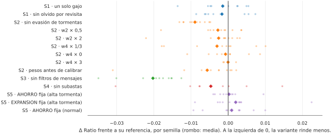
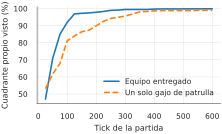
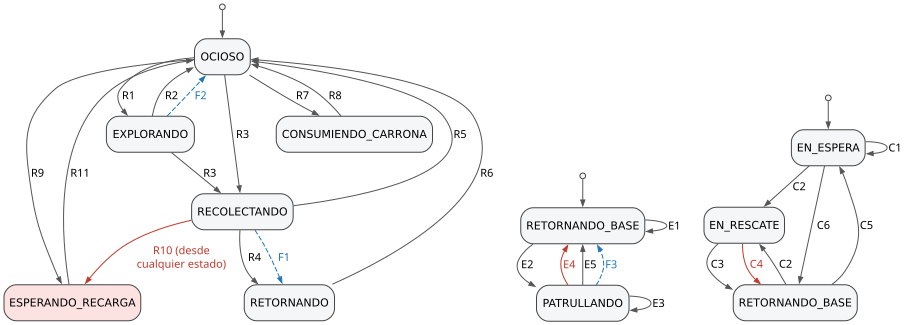
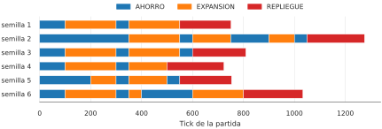
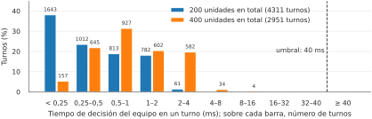
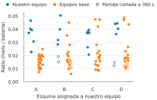
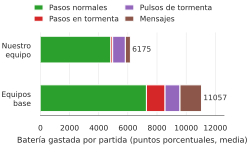

```{=typst}
#import "diagramas/secuencia.typ": secuencia, arquitectura
#align(center)[
  #text(size: 15pt, weight: "bold")[Informe técnico del Equipo X: facción «Permafrost»] \
  #text(size: 10.5pt)[Trabajo Final · Tópicos en Ciencias de la Computación (UPC) · Simulación multiagente competitiva en Marte] \
  #text(size: 10pt)[\[Integrante 1\] · \[Integrante 2\] · \[Integrante 3\] · \[Integrante 4\]]
]
#let v = json("valores.json")
#let t = v.t
#let c = v.c
#let x = v.x
#let l = v.l
#let k = v.cop
#set par(justify: true, leading: 0.55em, spacing: 0.75em)
#show heading.where(level: 1): set text(size: 12.5pt)
#show heading.where(level: 1): set block(above: 0.95em, below: 0.55em)
#show table: set text(size: 8.2pt)
#show table: set par(justify: false, leading: 0.4em)
#show figure.caption: set text(size: 8.8pt)
#show figure: set block(above: 0.8em, below: 0.8em)
#show raw: set text(size: 0.92em)
#set figure(gap: 0.5em)
```

El equipo se entrega en `equipoX.py` (clase `#c.CLASE`{=typst}, que hereda de `EquipoBase`), organizado en seis capas, una por sesión. Este informe sigue ese mismo orden. Los nombres en `monoespaciado` son funciones y constantes del código, y todos los números provienen de las corridas descritas en la sección de metodología.

::: {#tbl-mapa}
```{=typst}
#table(columns: (auto, 1fr, auto, 1fr), stroke: none, inset: (x: 4pt, y: 2.4pt), align: left,
  table.hline(stroke: 0.6pt),
  [*S1*], [Creencias, complejidad y olvido: Sesión 1 · cobertura: @fig-cob], [*S4*], [CNP, pujas, empates y expiración: Sesión 4 · secuencia: @fig-sec (a) y (c) · evidencia: @tbl-exp],
  [*S2*], [FSM: @fig-fsm y @tbl-fsm · $U(s,a)$ y pesos: Sesión 2, @tbl-pol y @tbl-exp], [*S5*], [Políticas: @tbl-pol · papeletas y matriz de Copeland: @tbl-pap y @tbl-cop · Ratio en alta tormenta: @tbl-exp],
  [*S3*], [Ontología y costo: @tbl-msg · secuencias: @fig-sec (a) y (b)], [*S6*], [Arquitectura: @fig-arq · complejidad y perfilado: Sesión 6, @tbl-lat],
  [*Base*], [Mecánicas obligatorias: @tbl-fsm (R10, E4, C4) · estabilidad: Sesión 6], [*Torneo*], [@tbl-torneo y @fig-torneo · limitaciones al final],
  table.hline(stroke: 0.6pt),
)
```
Dónde está cada criterio de la rúbrica.
:::

# Entorno y metodología de medición

El motor entregado (`simulador.py`) usa una grilla de 60 × 45, ticks lógicos de 0,12 s y tres tormentas de radio 5. **El enunciado habla de 100 unidades por equipo (60 rovers, 30 exploradores, 10 recargadores), pero el simulador entregado crea 50 (30, 15 y 5): todas las mediciones de este informe son con el simulador entregado, sin modificarlo.** Los rovers deciden cada dos ticks y los drones cada tick; la visión es un cuadrado de radio `#c.VISION_ROVER`{=typst} (rover), `#c.VISION_EXPL`{=typst} (explorador) y `#c.VISION_REC`{=typst} (recargador). Cada mensaje cuesta 0,5 % al emisor y 0,5 % al receptor, es decir, un punto de batería para el equipo.

Las partidas se corren sin ventana con `arena.py`, que importa el simulador tal cual, fija la semilla y registra, por equipo, el Ratio, el hielo depositado, la batería gastada por causa (pasos, pasos en tormenta, pulsos de tormenta y mensajes), los mensajes y los contadores internos del equipo. Se usan tres conjuntos de datos. (i) *Torneo*: `#t.partidas`{=typst} partidas, `#t.semillas`{=typst} semillas por cada una de las cuatro esquinas, contra tres copias del equipo base del curso. (ii) *Experimentos «con y sin»* (`experimentos.py`): `#x.n_variantes`{=typst} variantes × `#x.semillas`{=typst} semillas desde la esquina A; cada variante apaga o cambia una sola pieza y se compara, semilla a semilla, con el equipo completo (@tbl-exp, @fig-exp). (iii) *Latencia* (`latencia.py`): `#l.semillas`{=typst} partidas en un solo proceso. El arnés corta una partida a los 360 s simulados (3000 ticks) si el hielo no se agotó: ocurrió en `#t.cortadas`{=typst} de las `#t.partidas`{=typst} partidas del torneo y en `#x.cortadas`{=typst} de las `#x.partidas`{=typst} de los experimentos; en ellas el Ratio es el del momento del corte. La desviación del Ratio entre semillas va de `#x.sd_min`{=typst} a `#x.sd_max`{=typst} según la variante, así que una diferencia solo se trata como efecto si supera dos errores estándar de la diferencia pareada (asterisco en la @tbl-exp). Con ese criterio, las variantes con efecto sobre el Ratio son: `#x.claros`{=typst}.

::: {#tbl-exp}
```{=typst}
#include "tablas/experimentos.typ"
```
Experimentos «con y sin». Δ Ratio es la diferencia media por semilla frente a la referencia (el equipo completo; en las dos filas de política fija con alta tormenta, la fila con votación); el asterisco marca las que superan dos errores estándar. «Peor en» cuenta las semillas en que la variante queda por debajo de su referencia. «Bat.» es la batería total gastada, en puntos porcentuales sumados sobre las 50 unidades; «Bat. msj.» y «Bat. torm.», la parte gastada en mensajes y en tormentas; «V. vano», los viajes en vano por partida (Sesión 4).
:::

{#fig-exp width=100%}

# Sesión 1 · Percepción y estado interno

**Representación de creencias.** Cada unidad $i$ mantiene su propia memoria (`_memoria_de`); no existe un mapa de equipo. La creencia en el tick $t$ es $B_i^t = (H_i, R_i, T_i)$. $H_i : (x,y) \mapsto (q, \tau)$ asocia a cada celda la cantidad de hielo estimada y el tick de la última observación. $R_i : \mathit{id} \mapsto (\mathit{pos}, f, \tau)$ guarda los restos con su posición y su combustible $f \in \{20, 10\}$; se indexa por identificador porque así lo exige la acción `consumir_restos`. $T_i$ contiene, para cada tormenta vista en los últimos `#c.MEMORIA_TORMENTA`{=typst} ticks, la tupla $(x, y, \rho, \tau, v_x, v_y)$, con la velocidad estimada a partir de dos observaciones consecutivas (`_percibir_tormentas`), y un rastro con las últimas `#c.RASTRO_TORMENTAS`{=typst} posiciones observadas, que es la trayectoria reciente. El riesgo se evalúa sobre la posición proyectada un tick adelante, $(x + v_x \Delta t,\ y + v_y \Delta t)$ (`_centros`).

**Actualización y olvido** (`_percibir`). (a) Observación: toda celda visible $(x,y,q)$ fija $H_i(x,y) \leftarrow (q,t)$. (b) Olvido por revisita: una celda recordada que cae dentro de la visión y ya no aparece con hielo se borra; lo mismo vale para los restos. (c) Decaimiento: la confianza en una veta no revisitada es $\gamma(t,\tau) = 2^{-(t-\tau)/250}$ (`_confianza`, vida media `VIDA_MEDIA_HIELO`) y multiplica la ganancia en $U$. (d) Expiración: una veta o un resto se elimina si pasan más de `#c.OLVIDO_HIELO`{=typst} ticks sin verlo; como las partidas del torneo que terminan duran desde `#t.ticks_min`{=typst} ticks, en la práctica actúa primero el decaimiento. (e) Confirmación de un aliado: un `INFORM` de hielo escribe $(q,t)$ en la memoria del receptor, y con el campo `agotado` la borra; lo envía el rover que llega a una veta adjudicada por subasta y ya no la encuentra, al dron que se la adjudicó (`_objetivo_de_contrato`). Sin el olvido por revisita (`s1_sin_olvido`) los viajes a vetas ya agotadas pasan de `#x.completo.viajes`{=typst} a `#x.s1_sin_olvido.viajes`{=typst} por partida; el Ratio cambia `#x.s1_sin_olvido.delta`{=typst} (`#x.s1_sin_olvido.efecto`{=typst}).

**Complejidad espacial.** Por unidad es $O(|H_i| + |R_i| + |T_i|)$, con $|H_i| \le K$, el número de celdas con hielo. El generador reparte al menos 165 u. por cuadrante en celdas de 1 a 5 u. más 25 celdas centrales, unas 245 celdas en promedio, frente a las 2700 de la grilla; $|T_i| \le 5$ y el rastro está acotado a `#c.RASTRO_TORMENTAS`{=typst} entradas. Para el equipo la cota es $O(N K)$ con $N = 50$.

**Exploración y cobertura.** El cuadrante propio (30 × 22 = 660 celdas) se ve como un abanico de 90° desde la base, partido en `GAJOS` = `#c.GAJOS`{=typst} sectores de `#c.ANG_GAJO`{=typst}° (`_ruta_de_patrulla`). El explorador $j$ en su salida $s$ recorre la bisectriz del gajo $(j + s) \,\mathrm{mod}\,$ `#c.GAJOS`{=typst}, con puntos de paso al 60 % y al 100 % del radio $\min(r_{\max},$ `#c.RADIO_PATRULLA`{=typst}$)$, y al terminar toma el gajo siguiente; como cada dron empieza en un gajo distinto, los que patrullan a la vez no repiten franja. Con visión de radio `#c.VISION_EXPL`{=typst} la ventana es de 19 celdas de ancho, y a radio `#c.RADIO_PATRULLA`{=typst} el arco de un gajo mide `#c.ARCO_GAJO`{=typst} celdas, menos que la ventana: los gajos contiguos se solapan y no quedan huecos. `arena.py` mide la cobertura como la fracción de celdas del cuadrante que han estado dentro de la visión de alguna unidad viva del equipo. El equipo entregado alcanza el `#x.cob.completo.at("100")`{=typst} % al tick 100 y el `#x.cob.completo.at("600")`{=typst} % al tick 600; con todos los exploradores en un mismo gajo (`s1_un_solo_gajo`), el `#x.cob.s1_un_solo_gajo.at("100")`{=typst} % y el `#x.cob.s1_un_solo_gajo.at("600")`{=typst} % (@fig-cob). Sobre el Ratio, el gajo único da Δ `#x.s1_un_solo_gajo.delta`{=typst} (`#x.s1_un_solo_gajo.efecto`{=typst}), con desviación `#x.s1_un_solo_gajo.sd`{=typst} frente a `#x.completo.sd`{=typst} y `#x.s1_un_solo_gajo.cortadas`{=typst} partidas cortadas frente a `#x.completo.cortadas`{=typst}.

**Dos decisiones que se declaran.** Primera: no patrullan los 15 exploradores a la vez. Están de turno los que cumplen $(j - \lfloor t/$`#c.TURNO_PATRULLA`{=typst}$\rfloor) \,\mathrm{mod}\, 15 < e$ (`_de_turno`), donde $e$ es el parámetro `exploradores` de la política (`#c.EXPL_POR_POLITICA`{=typst}); el turno rota cada `#c.TURNO_PATRULLA`{=typst} ticks, de modo que todos patrullan a lo largo de la partida, y el resto espera en la base, donde no gasta. Además, un explorador de turno avanza solo uno de cada `cadencia` ticks. Segunda: un rover ocioso no busca sin pausa. Sale en rondas de `#c.TRAMOS_BUSQUEDA`{=typst} tramos en abanico (radios `#c.RADIOS_BUSQUEDA`{=typst}, en una dirección que depende de su índice), solo con batería de al menos `#c.BATERIA_BUSQUEDA`{=typst} %, y descansa `#c.DESCANSO_BUSQUEDA`{=typst} ticks entre rondas (`_buscar_o_esperar`); entre tanto queda en `OCIOSO`, atento a un `INFORM` o a una adjudicación. La razón de ambas es la métrica: cada paso cuesta un punto de batería y un rover ve una ventana de solo 11 celdas, mientras que un dron ve 19. En el torneo, la búsqueda de los rovers gasta `#t.pasos_explorando`{=typst} pasos por partida y la patrulla `#t.pasos_patrullando`{=typst}. El costo de estas decisiones es que el equipo recoge menos hielo que los rivales (Resultados).

{#fig-cob width=50%}

# Sesión 2 · Utilidad multi-atributo y FSM

{#fig-fsm width=100%}

**FSM por rol.** La @fig-fsm y la @tbl-fsm describen las tres máquinas tal como están en `_rover`, `_explorador` y `_recargador`. Cada decisión evalúa las guardas en orden de prioridad, y el estado queda en `memoria["estado"]`. Los estados son exactamente los del enunciado.

::: {#tbl-fsm}
```{=typst}
#grid(columns: (1fr, 1fr), column-gutter: 8pt,
table(columns: (auto, 1fr), stroke: none, inset: (x: 3pt, y: 2pt), align: left,
  table.hline(stroke: 0.6pt),
  [*R1*], [`OCIOSO`→`EXPLORANDO`: sin objetivo rentable, batería ≥ `BATERIA_BUSQUEDA` y descanso cumplido; va al punto del tramo.],
  [*R2*], [`EXPLORANDO`→`OCIOSO`: terminó los tramos de la ronda o la batería no alcanza; descansa `DESCANSO_BUSQUEDA` ticks.],
  [*R3*], [→`RECOLECTANDO`: $U("veta") > u_min$ o contrato CNP de hielo; `mover` y, sobre la veta, `extraer`.],
  [*R4*], [→`RETORNANDO`: carga completa; carga > 0 sin objetivo rentable; o fase final con carga > 0.],
  [*R5*], [`RECOLECTANDO`→`OCIOSO`: veta agotada, carga 0 y nada rentable.],
  [*R6*], [`RETORNANDO`→`OCIOSO`: $d("base") ≤ 2$: `depositar`.],
  [*R7*], [→`CONSUMIENDO_CARRONA`: carga 0 y $U("restos") > u_min$, o contrato CNP de restos; a $d ≤ 1$, `consumir_restos`.],
  [*R8*], [`CONSUMIENDO_CARRONA`→`OCIOSO`: fin del consumo; si no termina en `MAX_CONSUMO` decisiones, lo abandona.],
  [*R9*], [`OCIOSO`→`ESPERANDO_RECARGA`: en base, vacío y bat < `bat_pit`: `REQUEST` no urgente (recarga preventiva).],
  [*R10*], [Cualquiera→`ESPERANDO_RECARGA`: *bat ≤ 25 %*: se detiene (`solicitar_recarga`) y envía `REQUEST` urgente.],
  [*R11*], [`ESPERANDO_RECARGA`→`OCIOSO`: bat ≥ 90 %; la recarga preventiva vence a los 40 ticks.],
  [*Fin*], [*Últimos 30 s*: con carga, R4; sin carga, `OCIOSO` y `esperar` (moverse solo gasta), esquivando tormentas.],
  table.hline(stroke: 0.6pt),
),
table(columns: (auto, 1fr), stroke: none, inset: (x: 3pt, y: 2pt), align: left,
  table.hline(stroke: 0.6pt),
  [*E1*], [`RETORNANDO_BASE`: va a la base; en base con bat < 99 %, `recargar_en_base`; fuera de turno, espera.],
  [*E2*], [`RETORNANDO_BASE`→`PATRULLANDO`: de turno (`_de_turno`), sin recarga pendiente y no fase final.],
  [*E3*], [`PATRULLANDO`: avanza uno de cada `cadencia` ticks; al terminar un gajo toma el siguiente.],
  [*E4*], [`PATRULLANDO`→`RETORNANDO_BASE`: *bat ≤ 25 %* o bat ≤ $"1,2" d("base") + 28$ (lo justo para llegar).],
  [*E5*], [`PATRULLANDO`→`RETORNANDO_BASE`: fin del turno (relevo) o *fase final*.],
  table.hline(stroke: 0.3pt),
  [*C1*], [`EN_ESPERA`: en base; con bat < 99 % o sin carga, `recargar_en_base`.],
  [*C2*], [→`EN_RESCATE`: toma un `REQUEST` (libre, con carga y bat − $"2,3" d$ ≥ 29) o gana la subasta entre recargadores; confirma con `AGREE`.],
  [*C3*], [`EN_RESCATE`→`RETORNANDO_BASE`: a $d ≤ 1$, `recargar_aliado`; o el rover ya tiene ≥ 95 %, no está, o pasaron 160 ticks.],
  [*C4*], [`EN_RESCATE`→`RETORNANDO_BASE`: *bat ≤ 25 %* (envía `FAILURE` al rover) o sin carga.],
  [*C5*], [`RETORNANDO_BASE`→`EN_ESPERA`: $d("base") ≤ 2$.],
  [*C6*], [`EN_ESPERA`→`RETORNANDO_BASE`: desplazado fuera de la base por una tormenta.],
  table.hline(stroke: 0.6pt),
))
```
Transiciones de las tres FSM. $d$ es la distancia Chebyshev y «bat» la batería en %. En negrita, el manejo obligatorio de batería baja y de los últimos 30 s.
:::

**Función de utilidad.** `_elegir_objetivo` evalúa $U(s,a) = w_1\,\hat g - w_2\,\hat c + w_3\,\hat o - w_4\,\hat r$ (`_utilidad`) sobre las 14 vetas conocidas más cercanas y sobre los restos conocidos, con cada atributo normalizado a $[0,1]$. Sea $p$ la posición del rover, $b$ la base, $d$ la distancia Chebyshev (el paso diagonal cuesta lo mismo) y $L$ la carga libre. Para una veta en $c$ con cantidad $q$:

$$
\hat g = \frac{\min(L,\,G)\,\gamma(t,\tau)}{5},\qquad G = q + \frac{1}{2}\sum_{c' \ne c,\ d(c,c')\le 2} q'
$$

$$
\hat c = \frac{d(p,c) + d(c,b) - d(p,b)}{40},\qquad
\hat r = \frac{\text{n.º de muestras de la recta } p \to c \text{ con riesgo} > 0}{\min(d(p,c),\,8)}
$$

La ganancia cuenta la veta y la mitad de sus vecinas, limitada por la carga libre y descontada por la confianza; 5 es la capacidad del rover. El costo es *marginal*: cuánto alarga la vuelta a la base pasar por la veta, dividido entre 40 pasos; así un rover cargado prefiere vetas de camino. El riesgo es la fracción de la recta hacia el objetivo (hasta 8 muestras, `_riesgo_de_ruta`) que cae a menos de $\rho + \text{1,5}$ del centro proyectado de una tormenta recordada. Para unos restos en $r$ con combustible $f$, $\hat o = f'/20$ y $\hat c = 2\,d(p,r)/40$, con $f' = f$ si hay un aliado detenido a la vista y $f' = \min(f, 100 - \mathit{bat})$ si no. Así, $U_{\text{hielo}} = w_1 \hat g - w_2 \hat c - w_4 \hat r$ y $U_{\text{restos}} = w_3 \hat o - w_2 \hat c - w_4 \hat r$. La alternativa «retornar a la base» vale la utilidad de reserva $u_{\min}$ de la política: un objetivo solo se elige si la supera, y si ninguno lo hace el rover vuelve (con carga) o queda ocioso. Antes de puntuar se descartan los objetivos a más de $r_{\max}$ de la base y los inviables: se exige $\mathit{bat} - \text{1,15}\,[d(p,c) + d(c,b)] \ge 25 + 4$ (`_alcanza_bateria`).

**Calibración de pesos.** La @tbl-pol da los pesos por política. Con `AHORRO` una carga completa y reciente vale $\hat g = 1$, un desvío de 10 pasos resta $w_2 \cdot \text{0,25}$ y una ruta enteramente bajo tormenta resta $w_4$, que es mayor que la ganancia máxima, por lo que nunca se elige. El barrido de la @tbl-exp multiplica un peso y deja el resto igual. Duplicar $w_2$ da Δ `#x.s2_w2_doble.delta`{=typst} (`#x.s2_w2_doble.efecto`{=typst}; peor en `#x.s2_w2_doble.peor_en`{=typst} semillas), con hielo `#x.s2_w2_doble.hielo`{=typst} frente a `#x.completo.hielo`{=typst} y batería `#x.s2_w2_doble.bat`{=typst} frente a `#x.completo.bat`{=typst}. Reducirlo a la mitad lleva el hielo a `#x.s2_w2_mitad.hielo`{=typst} y la batería a `#x.s2_w2_mitad.bat`{=typst}, con Δ `#x.s2_w2_mitad.delta`{=typst} (`#x.s2_w2_mitad.efecto`{=typst}). Las variantes de $w_4$ (×0 y ×3) dan Δ `#x.s2_w4_cero.delta`{=typst} (`#x.s2_w4_cero.efecto`{=typst}) y `#x.s2_w4_triple.delta`{=typst} (`#x.s2_w4_triple.efecto`{=typst}). Con `#x.semillas`{=typst} semillas, el barrido no distingue los pesos elegidos de sus vecinos: los valores de la @tbl-pol se fijaron por el razonamiento de escala anterior. Las diferencias a favor de un $w_2$ menor o un $w_4$ mayor se anotan como hallazgo; los pesos no se cambiaron.

::: {#tbl-pol}
```{=typst}
#include "tablas/politicas.typ"
```
Parámetros de las cuatro políticas (tabla `POLITICAS`): pesos de $U$ y `#eval(c.LEYENDA_POLITICAS, mode: "markup")`{=typst}.
:::

**Tormentas.** Además del término $\hat r$ hay tres mecanismos. (i) `_mover`: si la unidad está en tormenta o el siguiente paso tiene riesgo, espera hasta `#c.MAX_ESPERA_TORMENTA`{=typst} decisiones, porque esperar no cuesta y un paso en tormenta cuesta 5 %. (ii) Agotada la espera, `_astar` busca un rodeo sobre el campo de riesgo: costo 1 por celda libre y $1 + 4 + 3\,\mathrm{riesgo}$ por celda en riesgo, heurística Chebyshev y tope de `#c.MAX_NODOS_ASTAR`{=typst} expansiones; devuelve el primer paso hacia el mejor nodo alcanzado. (iii) `_esquivar`: una unidad quieta a la que se le acerca una tormenta a menos de $\rho + \text{0,8}$ da un paso lateral (1 %) en vez de recibir el pulso (3 % y empuje). En el torneo se registran por partida `#t.esperas`{=typst} esperas, `#t.esquives`{=typst} esquives y `#t.astar`{=typst} búsquedas A\*. Sin estos mecanismos (`s2_sin_evasion`) la batería perdida en tormentas pasa de `#x.completo.bat_torm`{=typst} a `#x.s2_sin_evasion.bat_torm`{=typst} y el Ratio cambia `#x.s2_sin_evasion.delta`{=typst} (`#x.s2_sin_evasion.efecto`{=typst}; peor en `#x.s2_sin_evasion.peor_en`{=typst} semillas). Aun con evasión, las tormentas se llevan el `#t.pcttorm_n`{=typst} % de la batería del equipo (@fig-torneo).

**Carroña.** Un rover considera restos solo si va vacío, y entre los rovers que se ven va el más cercano. Al llegar ($d \le 1$) transfiere el combustible si ve un aliado detenido por batería y él mismo tiene al menos 70 %; en otro caso lo consume. La razón está en el simulador: la batería se satura en 100 %, de modo que a un rover con más de 80 % le sobraría parte de los 20 u., mientras que la transferencia reactiva al aliado detenido sin esperar a un dron. En el torneo se consumen `#t.carronas`{=typst} restos por partida.

# Sesión 3 · Comunicación FIPA-ACL

**Ontología.** Todo mensaje se construye con `_acl` y lleva los cinco campos `performative`, `sender`, `conversation_id`, `ontology` y `content`. Hay tres ontologías, `hielo`, `restos` y `recarga`, y las ocho performativas del enunciado (@tbl-msg). El identificador de conversación (`unidad-tick-contador`) enlaza el `CFP` con sus `PROPOSE`, `ACCEPT_PROPOSAL` y `REJECT_PROPOSAL`, y el `REQUEST` con su `AGREE` o `FAILURE`. Un mensaje mal formado se descarta sin afectar al resto de la bandeja (`_leer_mensajes`). `#t.msg_por_ont`{=typst}

::: {#tbl-msg}
```{=typst}
#include "tablas/mensajes.typ"
```
Ontología de mensajes y mensajes enviados por partida (media del torneo). Un mensaje equivale a un punto de batería.
:::

::: {#fig-sec}
```{=typst}
#grid(columns: (1fr, 1fr, 1fr), column-gutter: 6pt, row-gutter: 3pt, align: center + top,
  [#secuencia(ancho: 156pt, ([Rover], [Recargador 1], [Recargador 2]), (
    (nota: [bat ≤ 25 %: `solicitar_recarga`], sobre: 0, w: 104pt),
    (de: 0, a: 1, txt: [`REQUEST`]),
    (sep: [libre y cerca, o sin otros a la vista]),
    (de: 1, a: 0, txt: [`AGREE` {eta}], raya: true),
    (sep: [si no: subasta entre recargadores]),
    (de: 1, a: 2, txt: [`CFP` {vence: t + 2}]),
    (de: 2, a: 1, txt: [`PROPOSE` {puja}], raya: true),
    (de: 1, a: 2, txt: [`ACCEPT_PROPOSAL`]),
    (de: 2, a: 0, txt: [`AGREE` {eta}], raya: true),
    (nota: [va y `recargar_aliado`], sobre: 2, w: 84pt),
    (sep: [nadie puede]),
    (de: 1, a: 0, txt: [`FAILURE`], raya: true),
    (nota: [reintenta a los 40 ticks], sobre: 0, w: 84pt),
  ))],
  [#secuencia(ancho: 156pt, ([Dron], [Rover ocioso], [Rover lleno]), (
    (nota: [zona 5 × 5 con $sum q >= v_min$, sin rover a $d <= 5$, fuera de enfriamiento], sobre: 0, w: 118pt, h: 1.9),
    (de: 0, a: 1, txt: [`INFORM` hielo]),
    (nota: [$H("pos") <- (q, t)$; evalúa $U$], sobre: 1, w: 100pt),
    (sep: [restos sin rover a la vista]),
    (de: 0, a: 1, txt: [`INFORM` restos]),
    (nota: [$R("id") <- ("pos", f, t)$], sobre: 1, w: 100pt),
    (sep: [sobrante]),
    (nota: [se va lleno; quedan $>= v_min$ a la vista], sobre: 2, w: 124pt),
    (de: 2, a: 1, txt: [`INFORM` hielo]),
    (sep: []),
    (nota: [el destinatario lo elige el simulador: `api.enviar_a_rover_ocioso_cercano`], sobre: 1, w: 150pt, h: 1.9),
  ))],
  [#secuencia(ancho: 156pt, ([Dron], [Rover 1], [Rover 2]), (
    (nota: [zona $>= "1,8" v_min$ (o restos) y ≥ 2 rovers a la vista], sobre: 0, w: 150pt),
    (de: 0, a: 1, txt: [`CFP`]),
    (de: 0, a: 2, txt: [`CFP` {tarea, vence: t + 5}]),
    (de: 1, a: 0, txt: [`PROPOSE`], raya: true),
    (de: 2, a: 0, txt: [`PROPOSE` {puja}], raya: true),
    (nota: [en $t + 5$: menor puja; empate, menor id], sobre: 0, w: 128pt),
    (de: 0, a: 1, txt: [`ACCEPT`]),
    (de: 0, a: 2, txt: [`REJECT_PROPOSAL`]),
    (nota: [contrato: prioridad sobre $U$], sobre: 1, w: 100pt),
    (sep: [la veta ya no está al llegar]),
    (de: 1, a: 0, txt: [`INFORM`], raya: true),
    (nota: [{pos, agotado}: el dron la borra], sobre: 0, w: 110pt),
  ))],
  [(a) Auxilio de recarga], [(b) Reporte de hallazgos], [(c) Ciclo CNP de hielo o restos],
)
```
Diagramas de secuencia FIPA-ACL. Línea continua: mensaje que inicia o adjudica; discontinua: respuesta. «Dron» es un explorador o un recargador en tránsito. En (c), `ACCEPT` abrevia `ACCEPT_PROPOSAL`; el candidato que no puede cumplir un `CFP` no responde.
:::

**Protocolos.** La @fig-sec muestra los flujos. En el auxilio, el rover detenido envía un `REQUEST` al recargador con carga más cercano (`api.enviar_a_recargador_cercano`). Ese dron lo toma él mismo si puede y el rover está a $d \le 3$ o no ve a otro recargador; si no, lo subasta entre los recargadores que ve (Sesión 4). Quien asume el rescate lo confirma con `AGREE`, que solo se omite en la recarga preventiva con el rover al lado; si nadie puede, el rover recibe `FAILURE`. El rover reintenta con retroceso exponencial: tras $n$ pedidos sin recarga espera $\min(320,\ 20 \cdot 2^n)$ ticks, 60 si recibió un `AGREE`, y un `FAILURE` devuelve la espera a 40 (`_pedir_recarga`). Por partida hay `#t.requests`{=typst} `REQUEST`, `#t.agree`{=typst} `AGREE`, `#t.failure`{=typst} `FAILURE` y `#t.recargas`{=typst} recargas efectivas. En el reporte de hallazgos, un dron en vuelo (explorador, o recargador en tránsito) avisa de la zona de hielo más rica o de unos restos con un `INFORM` dirigido a un solo rover, o abre una subasta si hay a quién elegir.

**Filtros anti-saturación.** (1) Enfriamiento por incidente: una zona de 5 × 5 no se vuelve a reportar hasta pasados `enfriamiento` ticks, y unos restos hasta cuatro veces ese plazo (`_puede_reportar`). (2) Umbral de valor: solo se reporta una zona que sume al menos $v_{\min}$. (3) Si un rover activo ya está a distancia de visión del hallazgo, no se avisa. (4) Deduplicación entre drones: si varios drones en vuelo ven lo mismo, reporta el de menor identificador (`_cede_reporte`). (5) Los drones estacionados en la base no reportan. (6) Direccionamiento: todo es unicast, y el `CFP` va a lo sumo a $k$ candidatos. (7) Silencio en lugar de rechazo: no pujar no cuesta. (8) A lo sumo un reporte o una subasta por dron y turno, y ninguno con batería ≤ 30 % o en la fase final. Solo el enfriamiento (1) descarta `#t.filtrados`{=typst} reportes por partida.

**Gasto en comunicaciones.** En el torneo el equipo envía `#t.msg_n`{=typst} mensajes por partida, `#t.batmsg_n`{=typst} puntos de batería, el `#t.pctmsg_n`{=typst} % de su gasto total; los equipos base envían `#t.msg_b`{=typst} (`#t.pctmsg_b`{=typst} % de su gasto). Frente a la variante sin limitación de frecuencia (`s3_sin_filtros`, que apaga los filtros 1 a 5), el gasto en mensajes pasa de `#x.completo.bat_msg`{=typst} a `#x.s3_sin_filtros.bat_msg`{=typst} puntos por partida, con hielo `#x.completo.hielo`{=typst} frente a `#x.s3_sin_filtros.hielo`{=typst}, y el Ratio pasa de `#x.completo.ratio`{=typst} a `#x.s3_sin_filtros.ratio`{=typst} (Δ `#x.s3_sin_filtros.delta`{=typst}, `#x.s3_sin_filtros.efecto`{=typst}; peor en `#x.s3_sin_filtros.peor_en`{=typst} semillas).

# Sesión 4 · Coordinación mediante Contract Net

**Arquitectura.** Hay dos niveles. *Subasta implícita* (`_gana_subasta_implicita`), sin mensajes: entre los rovers activos que se ven, una veta cuyo grupo cabe en una sola carga, o unos restos, pertenecen al de menor par (distancia, id); como todos ven las mismas posiciones, todos calculan el mismo ganador. *CNP explícito* (`_abrir_subasta`, `_responder_cfp`, `_cerrar_subastas`), con el mismo ciclo para las tres ontologías: el iniciador preselecciona a lo sumo $k$ candidatos que tiene a la vista ($k$ = `k_cnp`, de `#c.K_MIN`{=typst} a `#c.K_MAX`{=typst} según la política), les envía el `CFP` con la tarea y el tick `vence`, recibe las pujas y, al vencer el plazo, adjudica con `ACCEPT_PROPOSAL` a la menor y envía `REJECT_PROPOSAL` al resto. Los casos son tres. *Hielo*: el iniciador es un dron que descubre una zona con al menos `#c.FACTOR_SUBASTA`{=typst} $v_{\min}$ y ve al menos dos rovers activos; el plazo es de `#c.PLAZO_SUBASTA`{=typst} ticks. *Restos*: igual, sin umbral de valor. *Recargas*: el recargador que recibe un `REQUEST` y no lo toma directamente lo subasta entre los recargadores que ve, con plazo de `#c.PLAZO_RECARGA`{=typst} ticks, y él mismo participa con su propia puja; así varios pedidos simultáneos se reparten sin duplicar viajes. Si no hay competencia a la vista, basta un `INFORM` dirigido.

**Pujas** (gana la menor). Con $\hat r$ el riesgo de ruta de la Sesión 2 (`_puja_rover`, `_puja_recargador`):

$$
\mathrm{puja}_{\text{hielo}} = \underbrace{d(p,c) + d(c,b)}_{\text{pasos estimados}} + \underbrace{\text{0,25}\,(100 - \mathit{bat})}_{\text{batería que falta}} + \underbrace{4 \cdot \mathit{carga}}_{\text{carga ocupada}} + \underbrace{25\,\hat r}_{\text{tormentas}}
$$

$$
\mathrm{puja}_{\text{restos}} = 2\,d(p,r) + \text{0,3}\,\mathit{bat} + 25\,\hat r,\qquad
\mathrm{puja}_{\text{recarga}} = 2\,d(p,\text{rover}) + \text{0,2}\,(100 - \mathit{bat}) + 25\,\hat r
$$

Por unos restos puja más bajo quien menos batería tiene, que es quien más los aprovecha. Un rover solo puja si está activo, tiene carga libre (vacío, si son restos), no tiene contrato ni otra propuesta pendiente, no es la fase final y la batería le alcanza para ir y volver; un recargador, si está libre, tiene carga y $\mathit{bat} - \text{2,3}\,d \ge 29$.

**Empates y expiración.** Las propuestas se ordenan por el par (puja, id): ante la misma puja gana el identificador menor. El iniciador solo cuenta las propuestas recibidas hasta el tick `vence`; una posterior se descarta porque la conversación ya no existe. Una propuesta compromete al candidato, que no puja en otra subasta, hasta `vence` + 2; pasado ese tick sin respuesta, expira (`_oferta_viva`). Si nadie pujó, la subasta queda desierta: el hallazgo se anuncia con un `INFORM` y, en una recarga, el rover recibe `FAILURE`. El ganador guarda el contrato, que tiene prioridad sobre $U$ mientras sea cumplible; si al recibirlo ya tiene otro, responde `FAILURE`. Por partida se abren `#t.sub_abiertas`{=typst} subastas`#t.sub_por_ont`{=typst}, de las que `#t.sub_adj`{=typst} se adjudican y `#t.sub_desiertas`{=typst} quedan desiertas, con `#t.msg_por_subasta`{=typst} mensajes por subasta.

**Evidencia.** Un «viaje en vano» es un rover cuyo objetivo de hielo desaparece de su memoria antes de llegar (contador `viajes_en_vano`). Sin subastas (`s4_sin_subastas`, que apaga ambos niveles) los viajes en vano pasan de `#x.completo.viajes`{=typst} a `#x.s4_sin_subastas.viajes`{=typst} por partida y la batería en pasos de `#x.completo.bat_pasos`{=typst} a `#x.s4_sin_subastas.bat_pasos`{=typst}. El hielo pasa de `#x.completo.hielo`{=typst} a `#x.s4_sin_subastas.hielo`{=typst}, la extracción por batería invertida de `#x.completo.hielo_por_bat100`{=typst} a `#x.s4_sin_subastas.hielo_por_bat100`{=typst} u. por cada 100 puntos, y el Ratio medio de `#x.completo.ratio`{=typst} a `#x.s4_sin_subastas.ratio`{=typst} (Δ `#x.s4_sin_subastas.delta`{=typst}, `#x.s4_sin_subastas.efecto`{=typst}; peor en `#x.s4_sin_subastas.peor_en`{=typst} semillas).

# Sesión 5 · Elección social y gobernanza

**Candidatos.** Las cuatro políticas son vectores de parámetros $\pi = (w_1..w_4,\ u_{\min},\ r_{\max},\ \ldots)$ (@tbl-pol): `EXPANSION` (utilidad de reserva baja, radio amplio, más exploradores), `AHORRO` (desplazamiento y tormenta más caros, radio corto, reportes más espaciados), `CARRONA` ($w_3$ alto; los drones reportan primero los restos) y `REPLIEGUE` (radio mínimo, un solo explorador, reportes solo de zonas muy ricas). La política vigente fija los pesos de $U$ y los umbrales de comunicación ($v_{\min}$, $k$, enfriamiento) de todas las unidades.

**Papeletas** (`_depositar_papeleta`). Cada unidad puntúa las políticas con su estado local: $\beta$ = batería/100; $\sigma = 1$ si está en tormenta o recuerda una; $n_r$ = vetas de 4 o 5 u. en su memoria; $n_c$ = restos en su memoria; y $\epsilon = 1$ (escasez) si no conoce hielo y lleva más de `#c.TICKS_SIN_HIELO`{=typst} ticks sin verlo ni recibir aviso:

$$
s_{\text{EXP}} = \text{0,45}\,\beta + \text{0,55}\min(1, n_r/4) - \text{0,4}\,\sigma,\qquad
s_{\text{AHO}} = \text{0,35} + \text{0,45}\,\sigma + \text{0,2}\,(1-\beta)
$$

$$
s_{\text{CAR}} = \text{0,6}\min(1, n_c/2) + \text{0,35}\,[\beta < \text{0,5}],\qquad
s_{\text{REP}} = \text{1,5}\,[\text{fase final}] \ \text{o, si no,}\ \text{0,75}\,\epsilon
$$

La papeleta es el orden decreciente de puntajes (empates según `ORDEN_POLITICAS`). Solo se opina en los 4 ticks previos a cada elección.

**Copeland** (`_copeland`). Cada `#c.PERIODO_VOTACION`{=typst} ticks se construye la matriz $M[a][b]$ = número de papeletas que prefieren $a$ a $b$. Cada duelo ganado suma 1 y cada empate 0,5; gana el mayor puntaje. Si hay empate, lo que incluye los ciclos de Condorcet, deciden el conteo de Borda entre los finalistas y luego el orden fijo `#c.ORDEN`{=typst}. *Regla de inercia*: para desplazar a la política vigente, la ganadora debe vencerla en el duelo directo por más del `#c.MARGEN_INERCIA_PCT`{=typst} % de los votantes; `REPLIEGUE` queda exenta. La @tbl-pap y la @tbl-cop muestran un ejemplo calculado con estas mismas funciones sobre `#k.n`{=typst} estados locales hipotéticos (el equipo guarda las matrices en `historial_votos`, pero el arnés no las exporta): gana `#k.ganadora`{=typst} por `#k.metodo`{=typst}, y frente a la vigente `#k.vigente`{=typst} el duelo directo queda `#k.a_favor`{=typst} a `#k.en_contra`{=typst}, ventaja `#k.ventaja`{=typst} frente a un umbral de `#k.umbral`{=typst}: ¿cambia la política? `#k.cambia`{=typst}.

::: {layout="[58,42]"}
::: {#tbl-pap}
```{=typst}
#include "tablas/papeletas.typ"
```
Ejemplo: papeletas que produce `_depositar_papeleta`.
:::

::: {#tbl-cop}
```{=typst}
#include "tablas/copeland.typ"
```
Ejemplo: matriz de pares y puntaje de Copeland.
:::
:::

**Lectura de la regla de integridad.** La política vigente (un nombre) y las papeletas (un orden de cuatro nombres por unidad) se comparten a nivel de equipo sin costo de mensaje. Es una lectura de la regla, que prohíbe evadir el costo al informar *hallazgos remotos (hielo, restos o solicitudes de rescate)*: ni la política ni las papeletas transportan posiciones, cantidades ni pedidos. Todo conocimiento de hielo, restos y rescates fuera de la visión propia viaja por `api`. Con una lectura más estricta, la votación costaría del orden de un mensaje por votante en cada elección.

**Comportamiento observado.** En el torneo hay `#t.elecciones`{=typst} elecciones y `#t.cambios`{=typst} cambios de política por partida (@fig-pol). Número de partidas, de `#t.partidas`{=typst}, en que rigió cada política: `EXPANSION` `#t.partidas_con_EXPANSION`{=typst}, `AHORRO` `#t.partidas_con_AHORRO`{=typst}, `CARRONA` `#t.partidas_con_CARRONA`{=typst} y `REPLIEGUE` `#t.partidas_con_REPLIEGUE`{=typst}. El equipo termina con `#t.vivas_n`{=typst} de 50 unidades vivas, así que hay pocos restos propios que voten por `CARRONA`. Por la forma de los puntajes, el voto depende sobre todo de $\sigma$: una unidad que ve una tormenta prefiere `AHORRO` y una que no la ve, `EXPANSION`, lo que explica la alternancia entre ambas. `REPLIEGUE` aparece también antes de la fase final, cuando la mayoría de las unidades lleva más de `#c.TICKS_SIN_HIELO`{=typst} ticks sin conocer hielo.

{#fig-pol width=100%}

**Impacto en el Ratio con alta tormenta.** El escenario añade tres tormentas de movimiento libre desde el inicio. Con votación el Ratio es `#x.s5_tormenta_votando.ratio`{=typst} ± `#x.s5_tormenta_votando.sd`{=typst}; con `AHORRO` fija, `#x.s5_tormenta_fija_ahorro.ratio`{=typst} ± `#x.s5_tormenta_fija_ahorro.sd`{=typst}; con `EXPANSION` fija, `#x.s5_tormenta_fija_expansion.ratio`{=typst} ± `#x.s5_tormenta_fija_expansion.sd`{=typst}. **`#x.veredicto_s5`{=typst}.** Lo que sí cambia con la política es el punto de operación: `AHORRO` fija trae `#x.s5_tormenta_fija_ahorro.hielo`{=typst} u. con `#x.s5_tormenta_fija_ahorro.bat`{=typst} puntos de batería, `EXPANSION` fija `#x.s5_tormenta_fija_expansion.hielo`{=typst} u. con `#x.s5_tormenta_fija_expansion.bat`{=typst}, y la votación `#x.s5_tormenta_votando.hielo`{=typst} u. con `#x.s5_tormenta_votando.bat`{=typst}. En el escenario normal, `AHORRO` fija da `#x.s5_normal_fija_ahorro.ratio`{=typst} frente a `#x.completo.ratio`{=typst} con votación (Δ `#x.s5_normal_fija_ahorro.delta`{=typst}, `#x.s5_normal_fija_ahorro.efecto`{=typst}), con `#x.s5_normal_fija_ahorro.hielo`{=typst} u. de hielo en lugar de `#x.completo.hielo`{=typst}. En las partidas con votación hubo `#x.completo.cambios`{=typst} cambios de política por partida en el escenario normal y `#x.s5_tormenta_votando.cambios`{=typst} con alta tormenta. La gobernanza cambia de verdad el comportamiento del equipo, pero en estos datos no mejora el Ratio.

# Sesión 6 · Arquitectura y rendimiento

::: {#fig-arq}
```{=typst}
#arquitectura()
```
Arquitectura modular: una llamada a `decidir_unidad` recorre las capas de izquierda a derecha.
:::

**Arquitectura.** La @fig-arq resume el recorrido de `decidir_unidad`: percepción y memoria (S1), lectura de mensajes (S3), papeleta (S5), FSM del rol con utilidad y navegación (S2) y reporte y subastas (S4). La capa S6 envuelve todo: mide el tiempo, cierra el turno anterior y, ante una excepción, devuelve una acción segura (`_accion_segura`: `solicitar_recarga` si es un rover con batería baja, `esperar` en otro caso), de modo que un error nunca llega al simulador. En las `#x.partidas`{=typst} partidas de los experimentos esa red atrapó `#x.errores`{=typst} errores, y en las `#t.partidas`{=typst} del torneo, `#t.errores`{=typst}. Además, el simulador original, con su interfaz Pygame, corrió 60 s en Python 3.8 con el equipo en dos esquinas sin excepciones.

**No bloqueo y optimizaciones.** No hay `time.sleep`, entrada/salida ni llamadas externas; el único bucle `while` es el de A\*, acotado a `#c.MAX_NODOS_ASTAR`{=typst} expansiones. Las optimizaciones son: estructuras $O(1)$ (`dict`, `set`) para memoria, reportes y subastas; A\* acotado, que además corre solo tras agotar la espera (`#t.astar`{=typst} veces por partida); riesgo de ruta por muestreo en lugar de búsqueda; evaluación perezosa de papeletas (solo en los 4 ticks previos a una elección), de objetivos (cada rover reevalúa cada 6 a 12 ticks, desfasado por índice para que no coincidan todos en un turno) y de subastas de recarga (solo si el dron no puede resolver el pedido directamente); y candidatos limitados a las 14 vetas más cercanas. El código no precalcula un campo de riesgo compartido por tick: cada unidad proyecta las tormentas que ella recuerda, que es lo coherente con una memoria por unidad.

**Complejidad.** Sea $h = |H_i| \le K$, $a$ los aliados visibles y $m$ los mensajes en la bandeja. Por decisión: percepción $O(v + h)$ con $v$ objetos visibles; mensajes $O(m)$; elección de objetivo $O(h \log h)$ por el ordenamiento más $14 \cdot (14 + a + 8\,|T_i|)$ operaciones, solo cuando toca reevaluar; movimiento $O(1)$, o a lo sumo $90 \cdot 8 \cdot |T_i|$ evaluaciones de riesgo y $O(\log 720)$ por operación de cola cuando corre A\*. Por turno deciden los 20 drones y, en los ticks pares, también los 30 rovers: como máximo 50 decisiones, $O(N\,(h \log h + a))$. La elección cuesta $O(N \cdot 4^2)$ una vez cada `#c.PERIODO_VOTACION`{=typst} ticks.

**Perfilado.** El equipo acumula con `time.perf_counter()` el tiempo de todas sus decisiones de un mismo tick (`ms_por_tick`), y `estadisticas()` devuelve media, p95, p99 y máximo. La @tbl-lat corresponde a `#l.ticks`{=typst} turnos en un solo proceso. *Condición de medición:* la carga media de la máquina en el último minuto era `#l.carga`{=typst}; con otros procesos en ejecución los valores son una cota pesimista. Cada semilla se corrió `#l.reps`{=typst} veces: como la simulación es determinista, el trabajo del equipo es idéntico entre repeticiones y lo que varía es el ruido del sistema operativo, de modo que la tabla muestra la repetición mediana de cada semilla. En ella el peor turno fue de `#l.max`{=typst} ms y el peor p99 de `#l.p99`{=typst} ms, frente al umbral de 40 ms; sin descartar ninguna repetición, el turno más lento observado fue de `#l.max_bruto`{=typst} ms, también bajo el umbral. En las corridas de torneo, hechas con varias partidas en paralelo, se registraron turnos aislados de hasta `#t.ms_max_torneo`{=typst} ms en nuestro equipo y `#t.ms_max_base`{=typst} ms en el equipo base; por eso no se usan como medida de latencia. Las mediciones son con 50 unidades por equipo, que es lo que crea el simulador entregado; con las 100 del enunciado el costo por turno sería aproximadamente el doble.

::: {layout="[60,40]" layout-valign="bottom"}
::: {#tbl-lat}
```{=typst}
#include "tablas/latencia.typ"
```
Tiempo de decisión del equipo por turno (`latencia.py`). La última fila toma la media de las medias y el peor valor de cada percentil.
:::

{#fig-lat}
:::

# Resultados del torneo

::: {#tbl-torneo}
```{=typst}
#include "tablas/torneo.typ"
```
Torneo: nuestro equipo en cada esquina contra tres equipos base. «cort.» son partidas cortadas a los 360 s simulados; «puestos 1–4», en cuántas partidas quedó primero / segundo / tercero / cuarto.
:::

En las `#t.partidas`{=typst} partidas el equipo obtiene un Ratio medio de `#t.ratio_n`{=typst} (mediana `#t.mediana_n`{=typst}, desviación `#t.sd_n`{=typst}, rango `#t.min_n`{=typst} a `#t.max_n`{=typst}) frente a `#t.ratio_b`{=typst} de los equipos base; queda primero en `#t.primeros`{=typst} partidas, segundo en `#t.segundos`{=typst}, tercero en `#t.terceros`{=typst} y cuarto en `#t.cuartos`{=typst} (@tbl-torneo). La diferencia está en el denominador: el equipo deposita `#t.rec_n`{=typst} u. de hielo por partida frente a `#t.rec_b`{=typst} de los rivales, pero gasta `#t.bat_n`{=typst} puntos de batería frente a `#t.bat_b`{=typst}, y termina con `#t.vivas_n`{=typst} de 50 unidades vivas frente a `#t.vivas_b`{=typst} (@fig-torneo). El resultado depende de la esquina (@tbl-torneo). En las `#t.n_term`{=typst} partidas que terminaron por agotamiento del hielo el Ratio medio es `#t.ratio_term`{=typst}; en las `#t.n_cort`{=typst} cortadas, `#t.ratio_cort`{=typst}.

::: {#fig-torneo layout-ncol=2 layout-valign="bottom"}




Torneo: Ratio de cada equipo en cada partida y desglose medio de la batería gastada.
:::

# Limitaciones

**Versión anterior.** Una versión previa del equipo, más agresiva en el ahorro (pocos exploradores fijos y rovers a la espera de avisos), obtuvo un Ratio medio de `#v.ant.ratio`{=typst} en `#v.ant.n`{=typst} partidas desde la esquina A (`#v.ant.hielo`{=typst} u. de hielo con `#v.ant.bat`{=typst} puntos de batería), pero no cumplía la patrulla continua de los exploradores ni la búsqueda activa de los rovers ociosos que pide el enunciado. Se priorizó el cumplimiento; la versión entregada obtiene `#x.completo.ratio`{=typst} en las mismas condiciones (`#x.completo.hielo`{=typst} u. con `#x.completo.bat`{=typst} puntos). Los datos de aquella versión están archivados en `reports/v-anterior/`.

Los rivales del torneo son tres copias del equipo base, no los equipos de otros grupos, y todas las pruebas usan 50 unidades por equipo. El equipo deposita menos hielo que el equipo base (`#t.rec_n`{=typst} frente a `#t.rec_b`{=typst} u.) y en `#t.cortadas`{=typst} de las `#t.partidas`{=typst} partidas del torneo el hielo no se agotó en 360 s simulados; en una partida oficial, sin ese corte, el juego seguiría hasta agotar el hielo y el Ratio final sería otro. Las tormentas siguen costando el `#t.pcttorm_n`{=typst} % de la batería, casi todo en pulsos de exposición (`#t.pulso_n`{=typst} puntos por partida, frente a `#t.pasotorm_n`{=typst} en pasos dentro de tormenta). De las piezas probadas, solo muestran efecto sobre el Ratio fuera del ruido las que la @tbl-exp marca con asterisco; el resto cambia otras magnitudes (viajes en vano, batería en tormentas, hielo y batería totales) sin mover el cociente de forma medible con `#x.semillas`{=typst} semillas. Otros límites del código: un rover sin carga no vuelve a la base durante los últimos 30 s, sino que espera donde está; cuando el ganador de una subasta declina con `FAILURE`, el iniciador no reasigna la tarea; las subastas solo alcanzan a candidatos que el iniciador tiene a la vista; y las matrices de votación de las partidas no se exportan, por lo que la @tbl-cop es un ejemplo y no una traza.

**Uso de herramientas de IA generativa.** En este trabajo se utilizó un asistente de IA generativa como apoyo en la implementación del código, en la ejecución y el análisis de los experimentos y en la redacción de este informe. El equipo revisó y validó el contenido.
